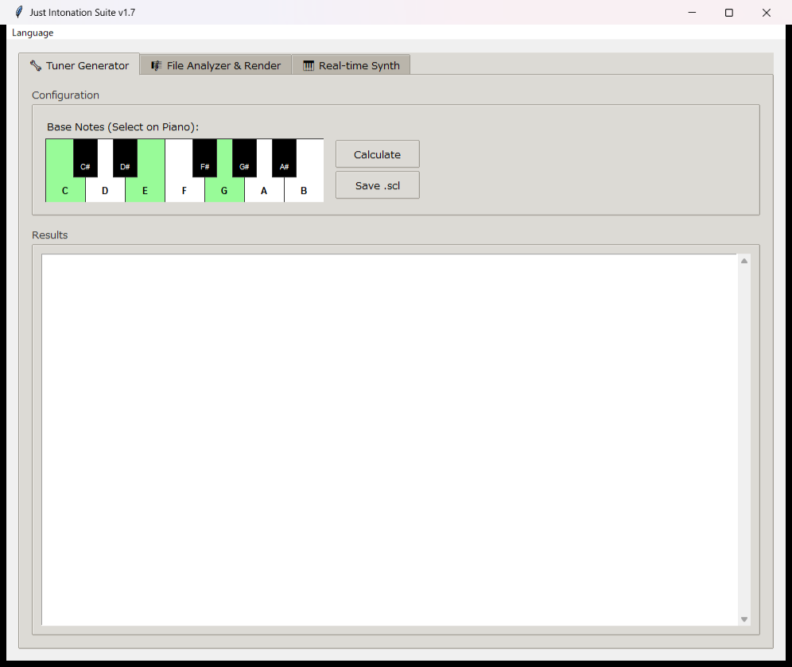

# Just Intonation Suite
※python3.14においてrt-midiは使えない可能性があります。その場合3.12で再試行してください。

## 概要

Just Intonation Suite は、用途に合わせて音律を最適化して使うためのツールです。

- **基音からチューニングを作成**：音を選んで最適化し、Scala `.scl` として保存できます。既存のDAWソフトで利用可能です。
- **MIDIファイルを解析・変換**：曲中の調や使用音を考慮して最適化し、WAVを再生・出力できます。
- **リアルタイム演奏**：基音を選び、MIDIキーボードの演奏に最適化した音律を適用できます。

GUI (`main.py`) と各機能を個別に実行するCLIを備えています。仕組みや最適化結果は[最適化の方法と評価](docs/optimization.md)を参照してください。

---

## 目次
- [特徴](#特徴)
- [リポジトリ構成](#リポジトリ構成)
- [依存関係](#依存関係)
- [インストール](#インストール)
- [クイックスタート (GUI)](#クイックスタート-gui)
- [コマンドラインツール](#コマンドラインツール)
- [チューニング最適化の概要](#チューニング最適化の概要)
- [ライセンス](#ライセンス)
---

## 特徴
- MIDI の調号（Key Signature）や楽曲内で実際に使われた音を解析して、曲に応じた 12 音のチューニング (log2 単位) を最適化（焼きなまし + SLSQP）。
- 最適化結果を Scala `.scl` 形式（Tuner で保存可能）で出力。
- MIDI → WAV の合成（最適化トーンで再生・ファイル書き出し）。
- リアルタイム MIDI 入力対応の簡易シンセ（サステイン、ADSR、倍音を含む波形）。
- GUI（tkinter）で操作可能：チューナー作成、MIDI 解析 & WAV 出力、リアルタイム・シンセの 3 タブ。

---

## リポジトリ構成
- `main.py` - GUI（Tuner / File Analyzer & Render / Real-time Synth）の統合アプリケーション。一般ユーザ向けのエントリポイント。
- `music.py` - MIDI ファイルの解析（調号優先）→ 最適化 → 合成、CLI 用スクリプト。
- `midi.py` - 対話型 CLI／リアルタイム・シンセ（簡易版）。端末で基音を入力して即時最適化・演奏が可能。
- `tuner.py` - 純正律の最適化ロジックと `.scl` 出力ユーティリティ（単体実行可能）。
- `README.md` - このファイル。

---

## 依存関係
推奨 Python バージョン: 3.8 以上

主要 Python パッケージ:
- numpy
- scipy
- sounddevice
- mido
- pretty_midi
- soundfile (PySoundFile)
- music21
- tkinter
- pypandoc

インストール例（venv 作成後）:
```bash
python -m venv venv
source venv/bin/activate   # Windows: venv\Scripts\activate
pip install --upgrade pip
pip install numpy scipy sounddevice mido pretty_midi soundfile music21 pypandoc
```

注: `sounddevice` は OS ごとに PortAudio のインストールが必要な場合があります。Linux では `libportaudio` を事前に導入してください。`pretty_midi` は `mido` と `numpy` が必要です。

---

## インストール（簡易）
1. リポジトリをクローン:
```bash
git clone https://github.com/potatoo1211/Just-Inotation-Suite.git
cd Just-Inotation-Suite
```
2. 仮想環境を作成して依存パッケージをインストール（上記参照）。

---

## クイックスタート (GUI)
GUI は `main.py` を実行します。シンプルなウィンドウで 3 つのタブが使えます。

```bash
python main.py
```



- Tab 1: Tuner Generator
  - 鍵盤で基準（基音）を複数選択し「Calculate」を押すと最適化を行い、ログやコピー用フォーマットを表示します。
  - `.scl` ボタンで Scala ファイルとして保存できます。

- Tab 2: File Analyzer & Render
  - MIDI ファイルを選択し、解析モード（Global / Center / Equal）を選んで「Run Analysis & Render WAV」を押すと解析 → 最適化 → WAV 出力を行います。
  - Global: Just Intonation を A=440 固定で最適化（デフォルト）。Center: 楽曲で最も多い音を中心に調整。Equal: 平均律で通常の MIDI 再生（最適化をスキップ）。

- Tab 3: Real-time Synth
  - MIDI 入力ポートを選択してシンセを起動できます。鍵盤から基準音を選び最適化して適用することもできます。MIDI キーボードでの演奏に対応。

---

## コマンドラインツール

- music.py（MIDI を解析・最適化・合成）
```bash
python music.py input.mid --out out_retuned.wav --tonic-mode global
# --tonic-mode: global | center
# 任意: --anneal-iters 2000
```

- midi.py（対話型。基音を入力して最適化 → MIDI 入力でリアルタイム演奏）
```bash
python midi.py
# プロンプトに基音（例: 0 7 9）を入力して最適化を実行、その後 MIDI ポートを選択して演奏
```

- tuner.py（対話型の最適化・.scl 保存）
```bash
python tuner.py
# プロンプトに基音（例: 0 4 7）を入力すると最適化結果を表示し、vital_tuning.scl を保存
```

---

## チューニング最適化の概要
- 共通の目的は、用途に応じた入力条件で12音の音律を最適化することです。
- `tuner.py` とリアルタイム・シンセは選択した基音を基に最適化し、`.scl` 保存や演奏に使います。
- `music.py` はMIDIの調号区間と実際に使われた音を解析して曲向けに最適化し、WAVを出力します。
- 焼きなまし法で候補を探し、SciPy の SLSQP で制約付きの微調整を行います。
- 詳しい目的関数、前提、評価方法、結果の記録状況は[最適化の方法と評価](docs/optimization.md)を参照してください。

## 方法と評価

各機能の役割と、基音ペアを指定した場合のスコア比較をまとめています。

[最適化の方法と評価を見る](docs/optimization.md)


---

## 貢献
バグ報告、改善提案、機能追加の PR を歓迎します。Issue を立てる際は再現手順（MIDI ファイルの添付や最小の入力例）、環境（OS / Python バージョン / 使ったコマンド）を記載してください。

---

## ライセンス

MIT License

Copyright (c) 2026 potatoo1211

Permission is hereby granted, free of charge, to any person obtaining a copy...

---
