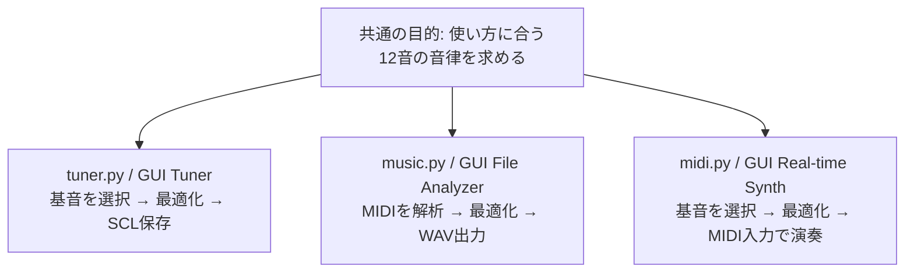

# 最適化の方法と評価

このページでは、Just Intonation Suite の各機能を紹介し、共通する音律最適化の考え方と、機能ごとの入力・出力・評価方法を説明します。プロジェクトには基音を直接指定する機能、MIDIファイルを解析する機能、MIDI入力で演奏する機能があります。

## 機能ごとの役割

これらは同じ目的を異なる使い方で提供する機能です。



| 機能 | 入力 | 何を最適化するか | 出力・用途 |
|---|---|---|---|
| `tuner.py` / GUI Tuner Generator | 利用者が選ぶ基音（ピッチクラス） | 指定した基音群に対する音程の誤差 | 音律値を表示し、Scala `.scl` として保存 |
| `music.py` / GUI File Analyzer & Render | MIDIファイル | 調号区間ごとに解析した実使用音を重視する、曲全体共通の音律 | 最適化した音律で再生し、WAVとして出力 |
| `midi.py` / GUI Real-time Synth | 利用者が選ぶ基音とリアルタイムMIDI入力 | 指定した基音群に対する音程の誤差 | 最適化した音律でMIDI入力を発音 |

`music.py` はこのうちファイル解析・レンダリングを担当する機能です。ほかの機能はMIDIファイルを解析せず、基音の直接指定やリアルタイム演奏に使います。GUI (`main.py`) はこの3種類の操作をタブにまとめています。

## 目的関数

各機能の最適化は、C を基準とした12音の `log2` オフセット `A` を求めます。隣り合う音の幅を `d` として、`A[0] = 0`、`A[1:] = cumsum(d)` と構成します。したがって、最適化変数は11個の音程幅で、幅は正、合計は1オクターブ未満という制約を持ちます。

目標比は `1/1, 16/15, 9/8, 6/5, 5/4, 4/3, 45/32, 3/2, 8/5, 5/3, 9/5, 15/8, 2/1` です。目標音程との差を `log2` 空間で計算し、その二乗を平均した値を最適化スコアに使います。平方根は最小値を変えないため最適化中には不要ですが、誤差の単位で比較するときは平方根を取ってRMSに戻します。

基音を直接指定する `tuner.py` / `midi.py` とGUIのチューナー機能では、指定基音群について固定の音程重みを使います。MIDI解析を行う `music.py` とGUIのファイル解析機能では、調号区間ごとに実際に鳴った音とオクターブを重み1、その他の音程を重み0.0001にします。調号情報がない場合は `music21` による小節単位の調推定にフォールバックします。したがって、同じ音律形式を求めても入力の扱いとスコアの重みは機能間で異なります。

最適化処理は焼きなまし法で候補を探し、SciPy の SLSQP で制約付きの微調整を行う流れです。実装と試行回数はスクリプトごとに異なります。`music.py` は既定で焼きなましを2,000回行い、`tuner.py` は1,500回の試行を10回行います。GUIでは機能に応じた最適化処理を呼び出します。

## RMS誤差低減率の定義

比較では、同じ入力・同じ重み付け条件に対して、次の2つの目的関数スコアを計算します。

- **平均律ベースライン**: `A[i] = i / 12` としたときのスコア。
- **最適化後**: 焼きなまし法と SLSQP を適用した後のスコア。

スコアは誤差の二乗平均なので、比率を比較するときは平方根を取ってRMS誤差に戻します。セント換算は `RMS cent = 1200 × √score` です。

```text
RMS誤差低減率 (%) = (√平均律スコア - √最適化後スコア) / √平均律スコア * 100
```

値が大きいほど、この目的関数上では目標純正比との誤差が小さくなっています。

## 基音ペアごとの比較

### 基音ペア `0 i` の実行結果

`tuner.py` に `0 1`、`0 2`、…、`0 11` を入力した場合の結果です。ここで `0` は C、`1`〜`11` は C♯〜B のピッチクラスです。これは2つの基音を同時に最適化対象にする比較で、MIDI ファイル内で1回転調する実験とは異なります。

平均律ベースラインは全ケースで同じです。各行の最適化後スコアは `tuner.py` の `optimize_A` を実行して得ました。設定は焼きなまし1,500反復を10回、その後 SLSQP で微調整です。SLSQP は全11ケースで成功しました。なお `tuner.py` は焼きなましの各試行で乱数 seed を0に戻す実装のため、10試行は同じ乱数系列から始まります。

表のスコアは `10⁻⁵ log₂²` 単位にスケールして有効数字3桁で表示しています。スコアの平方根を1200倍した加重RMS誤差もセントで示しました。低減率は丸め前のRMS誤差から計算しています。

このスコアは `tuner.py` の全音程重みを使った目的関数値です。音楽ファイル中の音符頻度や演奏音の音響的なうなりは含みません。

| 入力基音 | 平均律スコア<br>(×10⁻⁵ log₂²) | 最適化後スコア<br>(×10⁻⁵ log₂²) | 平均律 RMS<br>(cent) | 最適化後 RMS<br>(cent) | RMS誤差低減率 |
|---|---:|---:|---:|---:|---:|
| `0 1` (C, C♯) | 3.17 | 0.00168 | 6.75 | 0.155 | 97.6971% |
| `0 2` (C, D) | 3.17 | 0.824 | 6.75 | 3.44 | 48.9813% |
| `0 3` (C, D♯) | 3.17 | 0.495 | 6.75 | 2.67 | 60.4499% |
| `0 4` (C, E) | 3.17 | 0.00173 | 6.75 | 0.158 | 97.6601% |
| `0 5` (C, F) | 3.17 | 0.541 | 6.75 | 2.79 | 58.6744% |
| `0 6` (C, F♯) | 3.17 | 0.256 | 6.75 | 1.92 | 71.5365% |
| `0 7` (C, G) | 3.17 | 0.541 | 6.75 | 2.79 | 58.6717% |
| `0 8` (C, G♯) | 3.17 | 0.00158 | 6.75 | 0.151 | 97.7691% |
| `0 9` (C, A) | 3.17 | 0.496 | 6.75 | 2.67 | 60.4189% |
| `0 10` (C, A♯) | 3.17 | 0.828 | 6.75 | 3.45 | 48.8422% |
| `0 11` (C, B) | 3.17 | 0.00168 | 6.75 | 0.156 | 97.6968% |

## 現時点でできること

- **基音からチューニングを作成** (`tuner.py` / GUI Tuner): 基音を複数選択して音律を計算し、Scala `.scl` に保存する。
- **MIDIファイルを解析・レンダリング** (`music.py` / GUI File Analyzer): 調号と区間内の使用音から音律を計算し、WAVを再生・保存する。
- **MIDI入力でリアルタイム演奏** (`midi.py` / GUI Real-time Synth): 基音を選び、接続したMIDIキーボードの演奏に音律を適用する。

## アプリ画像

英語表示で起動した Tuner Generator の画面です。


